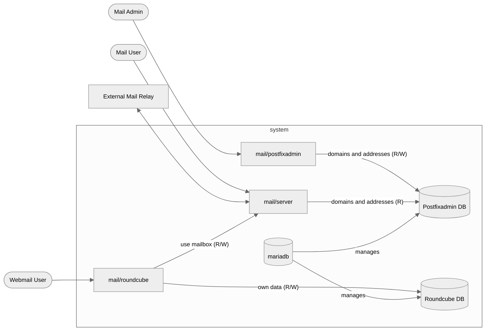

# Mermaid Templates

Shared Mermaid conventions for consistent, reusable diagrams across projects. This directory is language-neutral: the diagram vocabulary is defined once and referenced by every diagram – no duplication, no per-language variants.

## Files

- `style.snippet` – the standard `%%{init}%%` directive (neutral theme, 12 px font) so all diagrams share a consistent look.
- `example-components.mmd` – demo diagram with the shared artifact vocabulary (components, databases, actors) to copy from.

## Convention

Mermaid has no include mechanism, so the reuse principle from PlantUML (`docs/puml/`) is adapted:

- Every embedded Mermaid diagram is a Markdown code fence (` ```mermaid `) and **starts with the `%%{init}%%` directive from `style.snippet`** (copy-paste).
- Use consistent node IDs and labels, following the vocabulary of `example-components.mmd` (e.g. `roundcube`, `postfixadmin`, `mariadb`, `act_mail_user`). A diagram then only defines relationships (edges, labels) – not new spellings of existing artifacts.

## Example

`example-components.mmd` shows the same mail system as `docs/puml/example_components.puml`, rendered from a plain ` ```mermaid ` fence:

````markdown

````
